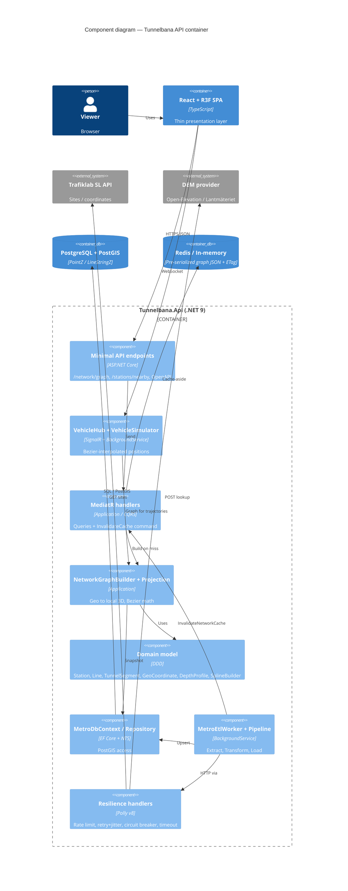

# Tunnelbana 3D — Stockholm Metro in 3D space

.NET 9 Clean Architecture + CQRS backend, PostGIS, SignalR, React Three Fiber thin client.

## Run
```bash
docker compose up --build
# Web UI:   http://localhost:8081
# Graph:    http://localhost:8080/api/v1/network/graph
# OpenAPI:  http://localhost:8080/openapi/v1.json
# Nearby:   http://localhost:8080/api/v1/stations/nearby?lat=59.3317&lon=18.0594&radiusM=1500
```
The ETL worker runs at startup (creates schema, seeds, enriches from SL + DEM), then every 24 h.
Until the first pass finishes the graph is empty (the UI polls). Not cached while empty.

Local dev: `docker compose up db redis` · `dotnet run --project src/Tunnelbana.Api` · `cd web && npm i && npm run dev`.

## Contract
Local ENU frame at T-Centralen: **X east, Y up (altitude m), Z south**, metres — Three.js-ready.
`GET /api/v1/network/graph` → `NetworkGraphDto { frame, nodes[{id,name,position,groundY,depthM}], lines[], edges[{fromNodeId,toNodeId,splineType:"cubic-bezier",controlPoints[4],lengthM}] }`.
Splines: uniform Catmull-Rom through platform positions → cubic Bezier (`C1=P1+(P2-P0)/6`, `C2=P2-(P3-P1)/6`), C1-continuous along a line.
SignalR `/hubs/vehicles`, client method `Vehicles(VehiclePositionDto[])`, ~4 Hz.

## C4 — Component diagram (API container)


## Read before relying on this
- **Depths are placeholders.** `SeedCatalog` values are indicative; SL's API has no depth data. Load authoritative data (Region Stockholm / Trafikverket as-builts) in the same ETL stage.
- **Coverage:** 7 stations / 3 lines to prove the pipeline. Extend `SeedCatalog` or derive topology from Trafiklab GTFS Sweden 3 (needs an API key).
- **Elevation:** Open-Elevation is coarse (SRTM ~30 m). Implement `IElevationProvider` against Lantmäteriet Markhöjd for finer DEM.
- Replace `EnsureCreated` with EF migrations; add auth on public endpoints; swap `VehicleSimulator` for GTFS-RT.
- Authored without compiling/running — expect minor package/API drift on first build.
